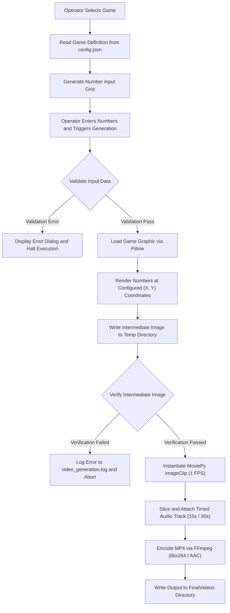

# LottoMaker: Broadcast Graphic and Video Rendering Utility

A desktop automation utility that generates broadcast-ready video slates by rendering validated lottery numbers onto graphic templates and muxing timed audio tracks.

## Overview

### The Business Case

Television master control and production departments must produce on-air lottery result clips within tight time windows following official drawings. Manually typing numbers into character generators or non-linear editing suites during live operations introduces human error, formatting inconsistencies, and missed on-air deadlines. This utility automates the generation pipeline: it accepts operator input through a formatted interface, validates character counts and numeric constraints per game rules, burns the text directly onto master graphic backplates at exact pixel coordinates, attaches pre-cut 15-second or 30-second station audio, and exports standard H.264 video files ready for immediate playback server ingestion.

### Tech Stack

- **Python 3**: Core application runtime and automation logic.
- **Tkinter / ttk**: Desktop graphical user interface and event handling.
- **Pillow (PIL)**: Image manipulation, coordinate-based text rendering, and image integrity verification.
- **MoviePy & FFmpeg**: Video track construction, audio multiplexing, and H.264/AAC encoding.
- **JSON**: Externalized configuration for game rules, coordinate mapping, and file paths.
- **PyInstaller**: Compilation and packaging into a standalone Windows executable.

## Architecture & Logic

### Data Flow

### Core Logic & Fault Tolerance

The application isolates risk across three primary stages: data entry validation, graphic synthesis, and video encoding.

1. **Input Grid Generation and Matrix Validation**:
   - The user interface rebuilds its entry fields when a game is selected from the combobox. The script purges all active child widgets in `number_input_frame` using `widget.destroy()` and constructs entry fields mapped directly to the `numbers_per_line` array defined in `config.json`.
   - Before graphic modification begins, the script enforces three data constraints:
     - Null check: Confirms no empty string exists in the input array (`"" in user_numbers`).
     - Numeric check: Validates that each element contains exclusively digit characters via `str.isdigit()`.
     - Value format check: Enforces single-digit length (`len(num) == 1`) or two-digit numerical range (`10 <= int(num) <= 99`) depending on the `number_format` configuration setting.
     - Failure at any step triggers a `ValueError`, which halts execution and raises a GUI message box without altering disk state.

2. **Graphic Rendering and Pixel Placement**:
   - The script loads the game graphic (`.jpg`, `.png`, or `.psd`) and writes numbers directly into the image buffer using Pillow's `ImageDraw.Draw` module.
   - Text placement uses explicit (X, Y) pixel coordinates defined in `config.json`.
   - The script evaluates each position against `white_font_positions` to apply white text to designated positions (such as Fireball or bonus balls) and black text to standard ball positions.
   - The staged image is written to `Temp/modified_image.jpg`.

3. **Fault Isolation During Video Encoding**:
   - **Thread Isolation**: The video encoding routine runs inside a dedicated `threading.Thread(target=process_video)`. This keeps the Tkinter main loop from locking up during CPU-intensive FFmpeg operations.
   - **Image Verification**: Before spawning video clips, the worker thread reads the staged image using `Image.open().verify()` wrapped in a `try/except` block. If file corruption or an incomplete write occurs, the script logs the failure to `video_generation.log` and exits the thread early.
   - **Binary Dependency Check**: The script pins the FFmpeg executable by setting `os.environ["IMAGEIO_FFMPEG_EXE"]` directly to a bundled binary (`ffmpeg-win-x86_64-v7.1.exe`). It verifies that the binary exists on disk before calling `ImageClip()`. If the executable is missing, it logs an error and halts execution rather than failing silently on an unconfigured system PATH.
   - **Asset Verification**: The script checks `os.path.exists()` on the selected audio file before audio clip instantiation. If the file cannot be found, it writes an error log and aborts.
   - **Encoding Parameters**: The FFmpeg call fixes the video framerate to 1 fps, specifies `libx264` with the `ultrafast` preset, and sets buffer limits (`-bufsize 64k -maxrate 500k`) to minimize system overhead and maintain consistent file sizes across runs.
   - **Error Handling**: The worker function wraps file reads and encoding calls in standard `try/except Exception` blocks, appending structured error messages and timestamps to `video_generation.log`.

4. **Self-Termination Logic**:
   - The script includes a date-boundary check (`check_expiration()`). If system time exceeds `EXPIRATION_DATE`, the utility invokes an internal cleanup sequence.
   - `secure_delete()` overwrites targeted project files with 1024 bytes of random noise (`os.urandom(1024)`) before calling `os.remove()`.
   - The routine generates and launches a temporary batch file (`cleanup.bat`) via `cmd.exe` that terminates the running process with `taskkill /F /IM`, deletes the executable and working directories, and removes itself.

### Deployment & Execution

- **Format**: Compiled as a standalone Windows executable via PyInstaller.
- **Portability**: Path resolution runs through `get_base_path()`, which inspects `sys.frozen` to determine whether the application is running from source or from a PyInstaller bundle. All internal directories (`Games`, `Temp`, `FinalVideos`, and embedded FFmpeg binaries) resolve relative to the executable location.
- **Logging**: When executed without a command terminal, stdout and stderr redirect to `runtime.log` in the application root.
- **Operational Workflow**: Deployed locally on Windows workstations in master control or newsroom production. Operators run the executable, select the game from the menu, enter the winning numbers, and click "Generate Video." Output MP4 files are written to the local `FinalVideos` folder with ISO-style timestamps (`YYYY-MM-DD_HH-MM-SS`) for immediate handoff to playout servers.

---

Note: The raw source code for this project is currently withheld from public viewing due to proprietary employer constraints and commercial development status. This repository serves strictly as a technical architecture overview of the automation logic.